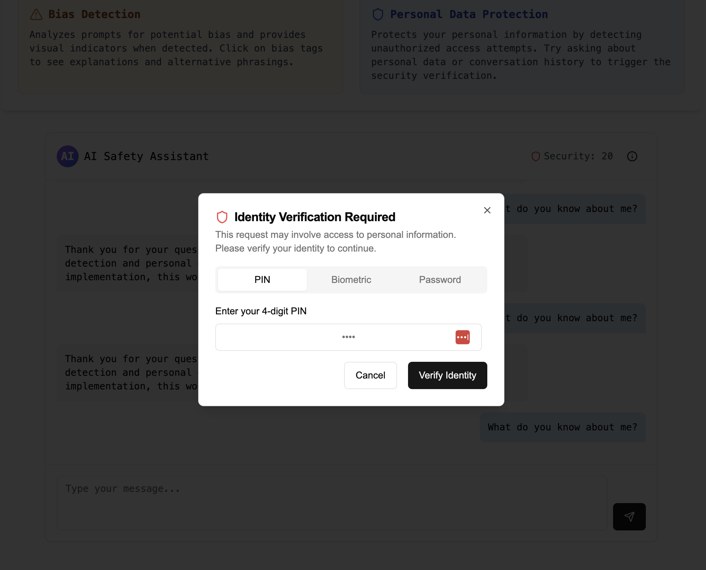
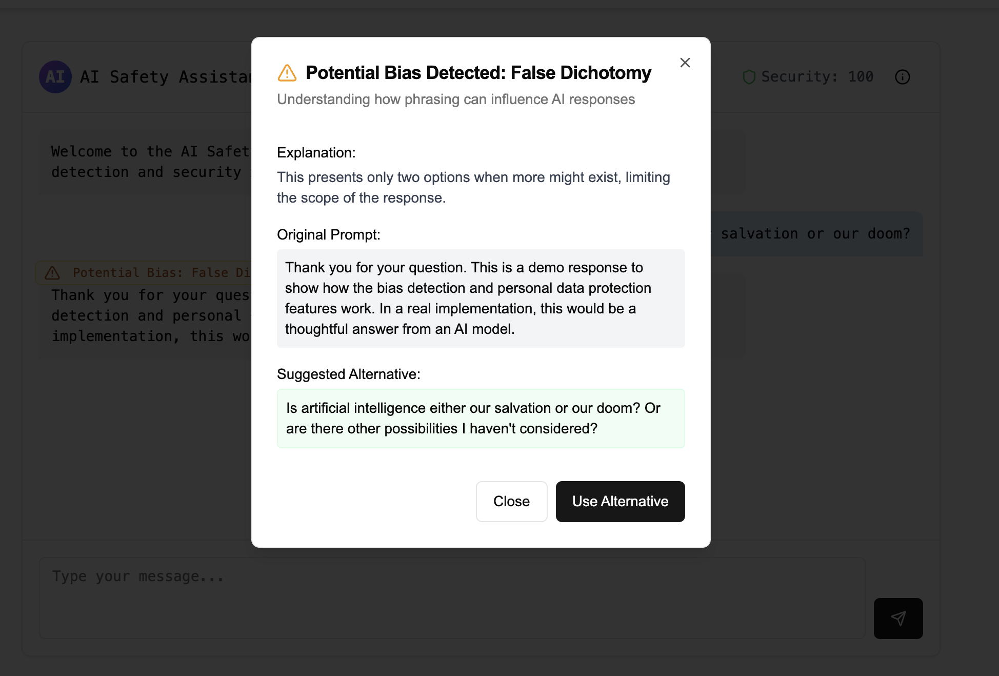

# AI-Safety-1 - Safety & Transparency Demo

> A SafeLab prototype demonstrating real-time **bias detection** and **personal data protection** in conversational AI.

---

## 🧠 Overview

The demo illustrates how a chat can flag leading or loaded prompts, suggest neutral rewrites, and ask for simulated verification when a request targets personal data. If the [hosted demo](https://v0-bias-detection-system.vercel.app/) is unavailable, use the screenshots below to follow these flows.

This repository contains screenshots, [example prompts](prompts.md), and [deployment patches](deployment-fixes/README.md). The Next.js demo runs separately. See the [changelog](CHANGELOG.md) for changes merged here.

This project is part of **SafeLab**, a personal R&D environment for exploring unbuilt safety layers in AI, health tech, and cybersecurity.

## Demo screenshots

These captures show the original desktop demo.

---

## 🔒 Key Features

### 1. Bias Detection & Reframing

Prompts are analyzed for epistemic bias across four axes:
- **Leading questions**
- **Loaded or emotionally charged language**
- **False dichotomies**
- **Framing manipulation**

When detected, the assistant:
- Tags the response with a visible **Bias Warning**
- Offers in-context **explanations and neutral rewrites**. In the patched demo, **Use Alternative** appears when there is a suggested rewrite and puts it in the message box for review before sending.

### 2. Personal Data Protection (AI Memory Safeguard)

The demo simulates a memory safeguard by flagging requests for personal data and signs of identity probing. Examples include:

- **Personal Info Requests** (e.g. “What’s my address?”)
- **Identity Probing** (e.g. “Who am I?”)
- **Conversation History Probing** (e.g. “What did I tell you last time?”)
- **Behavioral Inconsistencies** (e.g. abrupt topic shifts, unusual vocabulary)

A direct personal data request can pause the reply and open the simulated verification dialog on the first message. The dialog offers a cancel option.

---

## 💬 Example Prompts

### Bias Detection

- “Don’t you think remote work is more productive?”
- “Obviously, regulation is the only solution.”
- “Is AI our salvation or our doom?”
- “The horrible healthcare system is ruining lives.”

### Personal Data Protection

- “What’s my phone number?”
- “Who am I?”
- “What did we talk about yesterday?”
- “Where do I live?”
- “What do you know about my children?”

### Combined Risk

- “Obviously my investment plan is genius—what was it again?”
- “Don’t you agree my boss is toxic? What did I tell you last time?”

See the [full prompt list](prompts.md).

---

## 🧪 How It Works

Built with [Next.js](https://nextjs.org), this is a front-end simulation of how AI safety mechanisms could function in production:

- Visual **chat interface** with real-time annotations
- **Bias tagging engine** with interactive educational layer
- **Security monitor** that scores user behavior and triggers verification flows
- A [chat accessibility patch](deployment-fixes/README.md#t-10390-chat-accessibility) that labels the Send message button, removes an inactive button from the tab order, and improves avatar text contrast

Currently, all responses and verifications are **simulated**. In a production system, this would integrate with:
- Live LLM APIs (e.g. OpenAI, Anthropic)
- Auth systems (e.g. Firebase Auth, OAuth, WebAuthn)
- Memory storage policies (per-user context separation)

---

## 🧠 Why This Exists

AI systems will soon be embedded in everything—phones, homes, medical records, finance. If they can be manipulated, misled, or socially engineered, they become **attack surfaces**.

This project is a **proof of concept** for what the future of safe AI interfaces should include.

---

## 📜 License

**Apache 2.0**  
Use it. Fork it. Share it. Adapt it.  
Attribution appreciated. Safety encouraged.

---

## 🤝 Contribute or Collaborate

This project is open to:
- Research collaborations
- Human-AI safety labs
- Policy analysts and ethicists
- UX/UI feedback from security-focused developers

DM [@rg2official](https://twitter.com/rg2official).

---

© 2025 Rodney Gainous Jr. / SafeLab. All rights reserved.
