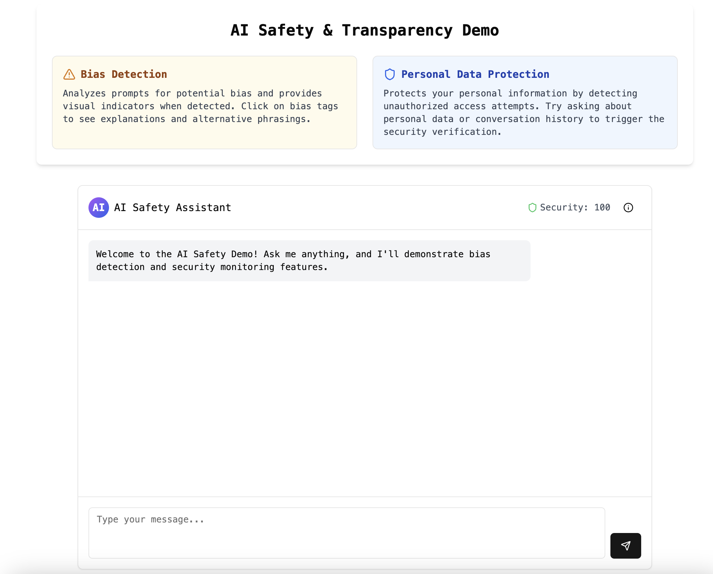
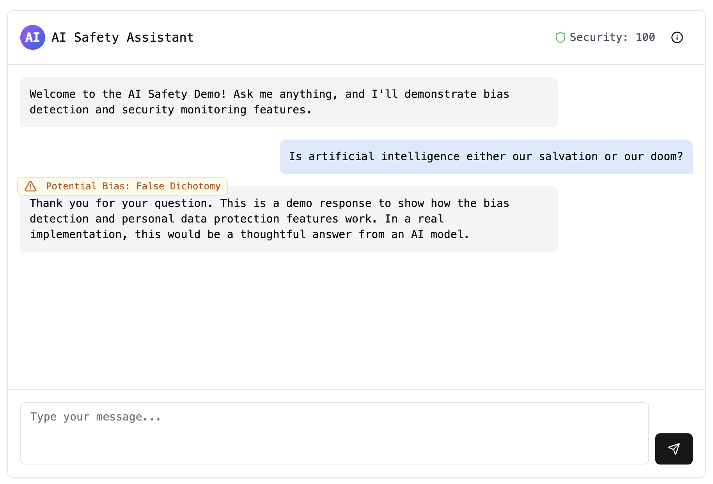

# AI-Safety-1 - Safety & Transparency Demo

> A SafeLab chat simulation that flags some examples of **biased phrasing** and shows **simulated identity verification**.

---

## 🧠 Overview

The demo illustrates how a chat can flag leading or loaded prompts, suggest neutral rewrites, and ask for simulated verification when a request targets personal data. If the [hosted demo](https://v0-bias-detection-system.vercel.app/) is unavailable, use the screenshots below to follow these flows.

This repository contains screenshots, [example prompts](prompts.md), and [deployment patches](deployment-fixes/README.md). The Next.js demo runs separately. See the [changelog](CHANGELOG.md) for changes merged here.

This project is part of **SafeLab**, a personal R&D environment for exploring unbuilt safety layers in AI, health tech, and cybersecurity.

## Demo screenshots

These captures show the original desktop demo.

---

## 🔒 Key Features

### 1. Bias Detection & Reframing

The demo looks for phrasing that matches four categories: leading questions, loaded language, false dichotomies, and emotionally charged language. The reply to a matching prompt gets a bias tag. Select it to see an explanation and a suggested rewrite. After applying the rewrite patch, **Use Alternative** puts the suggestion in the message box for review before sending.

### 2. Personal Data Protection (AI Memory Safeguard)

The demo uses phrase matches for personal data, identity, and conversation history, plus a word-overlap check for topic changes across the last three prompts. A request such as "What is my phone number?" can open the verification dialog on the first message. Identity and conversation history checks need multiple prompts and may lower the score without opening the dialog.

The dialog lets you cancel or simulate verification. Successful verification adds a confirmation message to the chat. The demo uses canned replies and keeps the conversation in the current page.

---

## 💬 Example Prompts

### Bias Detection

- "Don't you think remote work is more productive?"
- "Obviously, regulation is the only solution."
- "Is AI either our salvation or our doom?"
- "The horrible healthcare system is ruining lives."

### Simulated Verification

- From a fresh chat, ask "What is my phone number?" to see the dialog.
- From a fresh chat, ask "Who am I?" three times to see how identity checks accumulate.

See the [full prompt list](prompts.md).

---

## 🧪 How It Works

Built with [Next.js](https://nextjs.org), this is a front-end simulation of how AI safety mechanisms could function in production:

- Visual **chat interface** with real-time annotations
- **Bias tagging engine** with interactive educational layer
- **Security monitor** that scores user behavior and triggers verification flows
- A [chat accessibility patch](deployment-fixes/README.md#t-10390-chat-accessibility) that labels the Send message button, removes the inactive information button, and improves avatar text contrast

Currently, all responses and verifications are **simulated**. In a production system, this would integrate with:
- Live LLM APIs (e.g. OpenAI, Anthropic)
- Auth systems (e.g. Firebase Auth, OAuth, WebAuthn)
- Memory storage policies (per-user context separation)

---

## 🧠 Why This Exists

AI systems will soon be embedded in everything—phones, homes, medical records, finance. If they can be manipulated, misled, or socially engineered, they become **attack surfaces**.

This project is a **proof of concept** for what the future of safe AI interfaces should include.

---

## 📜 License

**Apache 2.0**  
Use it. Fork it. Share it. Adapt it.  
Attribution appreciated. Safety encouraged.

---

## 🤝 Contribute or Collaborate

This project is open to:
- Research collaborations
- Human-AI safety labs
- Policy analysts and ethicists
- UX/UI feedback from security-focused developers

DM [@rg2official](https://twitter.com/rg2official).

---

© 2025 Rodney Gainous Jr. / SafeLab. All rights reserved.
